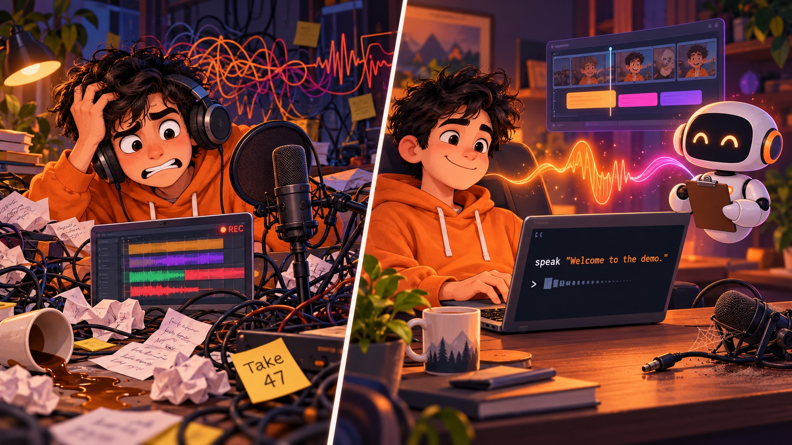

# voicestudio

[](LICENSE)




**Your voice, on tap, for every agent you run.**

```bash
speak "Welcome to the demo." --out welcome.wav
```

That's it. Your cloned voice, a WAV file, no cloud, no API key, no bill.

---

## Why

You wanted narrated decks, demo videos, voiceovers. You also own a microphone and a growing pile of abandoned "Take 47" files. Meanwhile your agents write the scripts in seconds and then stand there, mute.

`speak` is the missing wire. One command that any agent (Claude Code, Codex, Copilot, a cron job, a stray shell script) can call to turn text into audio **in your own voice** or any other voice you made, with timings, so a video builder knows exactly when each line starts.

It sits in front of [VoiceStudio](https://github.com/debpalash/VoiceStudio), the open-source local voice-cloning app, so the heavy lifting stays on your Mac. If the app isn't there, it falls back to macOS `say` and tells you it did.

## Real-world usage

**Speak a line in your voice:**

```bash
speak "Quarterly numbers are in." --out q3.wav        # default voice = your "me" alias
speak "Quarterly numbers are in." --voice "The Storyteller" --out q3.wav
```

**Turn a script into timed segments for video:**

```bash
speak --batch script.txt --out-dir narration/
```

Blank-line separated paragraphs become `seg-001.wav`, `seg-002.wav`, ... plus a `manifest.json`:

```json
{ "total_seconds": 5.09,
  "segments": [ { "index": 1, "text": "Welcome to the demo.", "start": 0.0, "end": 1.96, "duration": 1.96,
                  "file": ".../seg-001.wav", "engine": "voicestudio", "voice": "..." } ] }
```

Drop the `start`/`end` values straight into your slide or video timeline.

**See who can talk:**

```bash
speak voices            # your clones, imported voices, aliases
speak voices --all      # plus the stock macOS say voices
```

**Hand it to an agent:** the repo ships a skill for Claude Code and Codex and a Copilot snippet, and [docs/for_llms.md](docs/for_llms.md) is the one-page cheat sheet. After that an agent can answer "narrate this in my voice" on its own.

## Install

1. Install the [VoiceStudio](https://github.com/debpalash/VoiceStudio) app (open source, AGPL, Apple Silicon Mac, about 10 GB). Read their install script before you pipe it to a shell.
2. Make a clone of your own voice in the app (Profiles, New, record a clean 10 to 30 second clip). Or import a designed voice from its Archetypes gallery with "Use voice".
3. Get `speak` on your path:

```bash
git clone https://github.com/fkchang/voicestudio ~/work/voicestudio
mkdir -p ~/.local/bin && ln -sf ~/work/voicestudio/bin/speak ~/.local/bin/speak
```

4. Point the `me` alias at your clone (your personal prefs live outside the repo):

```bash
mkdir -p ~/.config/voicestudio
cp ~/work/voicestudio/config.example.json ~/.config/voicestudio/config.json   # then edit "me"
```

## How it works

| Piece | What it does |
|---|---|
| `bin/speak` | About 180 lines of Ruby, standard library only, runs on macOS system Ruby |
| VoiceStudio app | Serves a local REST API on `127.0.0.1:3900`; `speak` starts it if it isn't running |
| `GET /profiles` | Resolves your voice name (profile name, id, alias or prefix) |
| `POST /generate` | Returns a 24 kHz mono WAV; long text is chunked and crossfaded by the app |
| `say` fallback | Used only when the app is unavailable; stderr says so, and `--json` reports the engine |

Compute is roughly 5 seconds per second of audio on an M-series Mac, so batch your scripts instead of calling it per sentence.

## Options

```
speak "text" [--voice NAME] [--out FILE.wav] [--play]
speak --file script.txt [--out FILE.wav]
speak --batch script.txt --out-dir DIR
speak voices [--all]
      --speed N   --language L   --engine voicestudio|say   --json
```

Exit codes: `1` usage, `2` synth failed, `3` unknown voice, `4` no engine.

## Voices and consent

Clone your own voice, or one you have permission to use. Never clone someone else without their consent, and agents must never record or upload voice samples on their own. Nothing leaves your machine, and there is no key or token anywhere.

<details>
<summary><b>Why not an MCP server, or utts?</b></summary>

VoiceStudio already ships an MCP server, and it's fine for interactive sessions. A command wins for agents: it works in every agent and script, costs zero context tokens until someone asks for audio, writes files you can hand to a video builder, and starts the app itself. MCP tools can still sit alongside it.

For spoken notifications and hooks, a fast play-only engine is the right tool, not a 17 second voice clone. `speak` is for narration.

</details>

## License

MIT. VoiceStudio is AGPL-3.0 and is not bundled here; `speak` only talks to it over HTTP.
